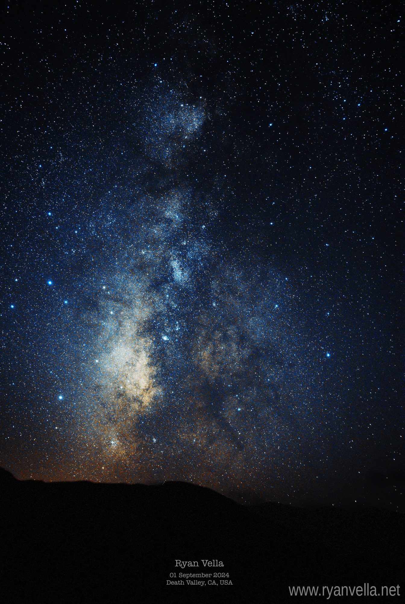

  
Atmospheric scientist &middot; ETH Zurich

  <h1 class="display">Ryan Vella</h1>
  
My work sits at the intersection of atmospheric physics and chemistry, climate science and Earth-system modelling &mdash; with a particular interest in the processes that shape clouds, and the part they play in the climate system.

<figure class="page__cover" style="background-image: url('/images/cover-clouds-poster.jpg');">
  <video class="page__cover-video" autoplay muted loop playsinline preload="metadata"
    poster="/images/cover-clouds-poster.jpg" aria-hidden="true" tabindex="-1">
    <source src="/images/cover-clouds.mp4" type="video/mp4">
  </video>
</figure>

<section class="band">

<h2 class="section-head">About</h2>

I am a postdoctoral scientist in the <a href="https://iac.ethz.ch/group/atmospheric-physics.html">Atmospheric Physics group</a> of Prof. Ulrike Lohmann at ETH Zurich, where I am investigating the role of ice-nucleating particles in mixed-phase clouds using global climate models.

I completed my PhD at the <a href="https://www.mpic.de/2285/en">Max Planck Institute for Chemistry</a> and the <a href="https://www.blogs.uni-mainz.de/fb08-ipa-en/">Institute for Atmospheric Physics</a>, Johannes Gutenberg University Mainz. Under the supervision of Prof. Jos Lelieveld and Prof. Holger Tost, my doctoral research focused on vegetation&ndash;climate interactions, specifically the role of biogenic volatile organic compound emissions in the Earth system.

Before my PhD, I completed a fellowship in Earth Observation at the <a href="https://www.esa.int/">European Space Agency (ESA)</a> in Frascati, Italy. I hold a BSc in Physics &amp; Mathematics and an MSc in Geosciences from the <a href="https://www.um.edu.mt/">University of Malta</a>.

<figure class="band-media band-media--portrait">

<ul class="band-contact">
<li>Email<a href="mailto:ryan.vella@env.ethz.ch">ryan.vella@env.ethz.ch</a></li>
<li>Scholar<a href="https://scholar.google.com/citations?user=T3QXwYwAAAAJ&amp;hl=en">Google Scholar</a></li>
<li>GitHub<a href="https://github.com/ryanvella9">ryanvella9</a></li>
<li>LinkedIn<a href="https://www.linkedin.com/in/ryan-vella-561a31145">Ryan Vella</a></li>
<li>Based inZurich, Switzerland</li>
</ul>
</figure>
</section>

<section class="band">

<h2 class="section-head">Research</h2>

<ul class="topics">
<li><strong>Aerosol&ndash;cloud interactions.</strong> How particles seed droplets and ice crystals, still the largest single uncertainty in the climate forcing record.</li>
<li><strong>Cloud physics.</strong> The microphysics inside a cloud: nucleation, growth, freezing, and the step from droplet to precipitation.</li>
<li><strong>Aerosol&ndash;climate interactions.</strong> The response of the climate system to aerosol, from direct scattering of sunlight through to circulation change.</li>
<li><strong>Earth-system modelling.</strong> Coupled global models, used to follow how a change in one part of the system propagates through the rest.</li>
<li><strong>Vegetation&ndash;atmosphere interactions.</strong> Biogenic volatile organic compounds, and the chemistry that couples the land biosphere to aerosol and cloud.</li>
<li><strong>Convection.</strong> How convection organises, carries moisture and aerosol upward, and drives extreme rainfall.</li>
</ul>

I also work on Earth observation and satellite remote sensing, shipping emissions, and light pollution.

<figure class="band-media">
<video autoplay muted loop playsinline preload="metadata" poster="/images/icon-ham-globes-poster.jpg" aria-hidden="true" tabindex="-1">
<source src="/images/icon-ham-globes.mp4" type="video/mp4">
</video>
<figcaption>Aerosols, clouds and precipitation in a global ICON&ndash;HAM simulation, 1999&ndash;2010. Aerosol optical depth at 550&nbsp;nm split by species (left), total cloud cover (centre) and precipitation rate (right).</figcaption>
</figure>
</section>

<section class="band">

<h2 class="section-head">Beyond research</h2>

I co-founded and managed the environmental NGO G&#295;aqda Si&#289;ar Maltin in Malta, dedicating several years to promoting ecological sustainability. I am passionate about trees, birds, and the natural environment. I enjoy working with satellite data and also operate several personal environmental sensors in Malta. As part of my conservation work, I help to raise awareness about light pollution and advocate for the preservation of Malta&rsquo;s remaining Dark Sky Heritage Areas. Beyond these projects, I enjoy biking, hiking, and capturing the beauty of nature through photography.

<a href="/files/rv_cv.pdf" download>Download curriculum vitae (PDF)</a>

<figure class="band-media">

<figcaption>Dark Sky Heritage Area, Malta.</figcaption>
</figure>
</section>

Last updated 30 August 2026.

