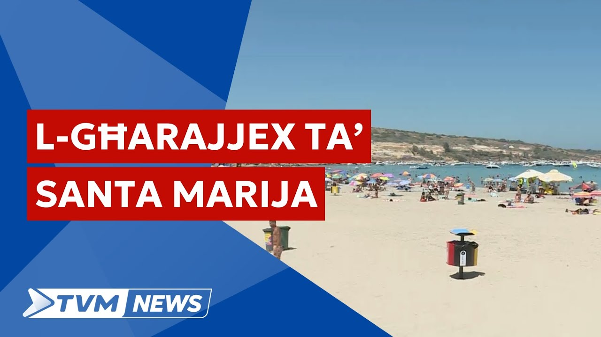

<h2 class="section-head">Latest</h2>

<figure class="fig">

</figure>

<a href="https://timesofmalta.com/article/warmer-seas-stronger-storms-science-says.1133290">Warmer seas, stronger storms: what the science actually says</a>

Op-ed, Times of Malta, 30 August 2026, with James Ciarl&ograve;

Warmer seas do not predict the next storm &mdash; they raise the odds of stronger ones.

Written as a follow-up to <b>&ldquo;Why major autumn storms could be on the horizon&rdquo;</b> (21 August), in which I was <a href="https://timesofmalta.com/article/malta-unusually-warm-seas-fuel-stronger-autumn-storms-experts-say.1133005">interviewed by Matthew Bonanno</a> on the marine heatwave running about 3&deg;C above normal.

<h2 class="section-head">Press and commentary</h2>

<ul class="medialist">
<li>

<a href="https://timesofmalta.com/article/malta-unusually-warm-seas-fuel-stronger-autumn-storms-experts-say.1133005">Why major autumn storms could be on the horizon</a>

Interview, Times of Malta, 21 August 2026

&ldquo;What the warm sea guarantees is the fuel.&rdquo; Interviewed by Matthew Bonanno.

</li>

<li>

<a href="https://tvmnews.mt/news/nistennew-li-dawn-il-maltempati-jkunu-iktar-frekwenti-u-bsahhithom/">&ldquo;Nistennew li dawn il-maltempati jkunu iktar frekwenti u b&rsquo;saħħithom&rdquo;</a>

Television, TVM News, 20 January 2026 (in Maltese)

On the severity of Storm Harry, and why extreme weather in the central Mediterranean is expected to become more frequent and more intense.

<button type="button" class="media-play" aria-label="Play the TVM News segment on Storm Harry"></button>

</li>

<li>

<a href="https://timesofmalta.com/article/maltese-atmospheric-climate-scientist-attends-lindau-meeting.1113716">Maltese atmospheric and climate scientist attends Lindau meeting</a>

Feature, Times of Malta, 27 July 2025

The annual Lindau Nobel Laureate Meeting brings together Nobel Prize laureates and young scientists from around the world.

</li>

<li>

<a href="https://tvmnews.mt/news/l-gharajjex-jintensifikaw-fnofs-awwissu-meta-l-wicc-tal-bahar-jilhaq-it-30-grad/">&ldquo;L-għarajjex jintensifikaw f&rsquo;nofs Awwissu, meta l-wiċċ tal-baħar jilħaq it-30 grad&rdquo;</a>

Television, TVM News, 15 August 2024 (in Maltese)

How Malta&rsquo;s convective summer thunderstorms &mdash; locally known as <em>għarajjex</em> &mdash; form once the sea surface climbs past 30&deg;C.

<button type="button" class="media-play" aria-label="Play the TVM News segment on summer thunderstorms"></button>

</li>

<li>

<a href="https://timesofmalta.com/article/shipping-industrys-heavy-toll-on-the-environment.834511">Shipping industry&rsquo;s heavy toll on the environment</a>

Op-ed, Times of Malta, 26 November 2020

Air pollution from ships is linked to some 40,000 premature deaths worldwide each year, and the industry accounts for around four per cent of anthropogenic greenhouse gas emissions.

</li>
</ul>

<h2 class="section-head">Public engagement</h2>

<ul class="medialist">
<li>

<a href="https://www.scientifica.ch/">Scientifica</a>

Exhibit, Zurich, August 2026

Ran a stand at the public science festival of ETH Zurich and the University of Zurich, held across the city over nine days.

</li>

<li>

<a href="https://www.scienceinthecity.org.mt/">Science in the City</a>

Exhibit, Valletta, September 2019

Ran a stand at Malta&rsquo;s national science and arts festival, which fills the streets of Valletta each autumn.

</li>

<li>

Light pollution in Malta

Public talk, Malta, June 2019

Given at the invitation of <a href="https://www.maltastro.org/">The Astronomical Society of Malta</a>.

</li>

<li>

<a href="https://www.scienceinthecity.org.mt/">Science in the City</a>

Exhibit, Valletta, September 2016

Ran a stand at Malta&rsquo;s national science and arts festival, which fills the streets of Valletta each autumn.

</li>
</ul>

